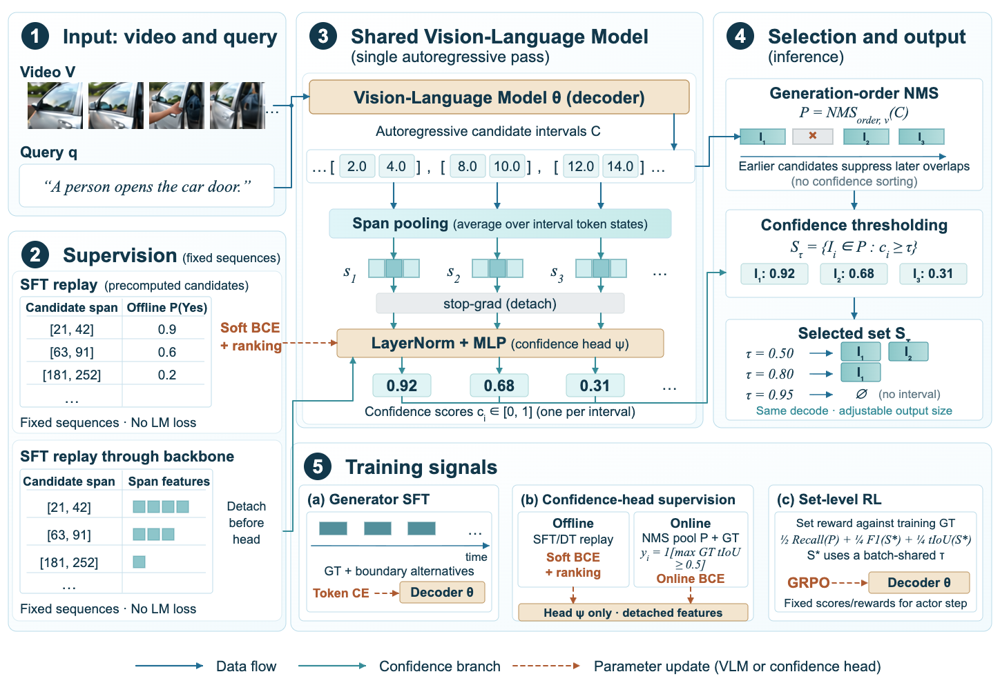

<div align="center">

# Grounding with Confidence

### Controllable Generative Video Temporal Grounding

**Generate once. Rank, select, or reject.**

[Overview](#overview) · [Results](#results) · [Models](#models) · [Quick Start](#quick-start) · [Evaluation](#evaluation) · [Training](#training-and-data)

</div>

Official implementation of **Grounding with Confidence: Controllable Generative Video Temporal Grounding**.

[Read the paper on arXiv (2609.39883)](https://arxiv.org/pdf/2609.39883).

> Inference, evaluation, and training code are included. Hugging Face weights are pending upload; original training videos and offline verifier labels are not bundled. Public-wrapper GPU validation and license approval remain [release gates](docs/release.md).

## Overview

Generating candidate intervals and deciding which ones to return are distinct tasks. **Grounding with Confidence** equips generative video temporal grounding with an interval-level confidence head, allowing the same decoded candidates to serve different application requirements.

- **Score in the original grounding pass.** A lightweight head reads cached decoder states, without adding confidence tokens or invoking an external verifier at inference.
- **Choose what to return.** Use confidence for ranking, threshold-based selection, or rejection, without generating the candidates again.
- **Learn generation and selection.** Distinct supervision trains the generator and confidence head, while set-level reinforcement learning rewards candidate coverage and the quality of the selected set.

<p align="center">
  
</p>

## Results

**Learning what to return increases the value of a single generation.** On OMTG-Bench, confidence improves selection from the same candidate pool, with the largest gains under tight return budgets.

Official query-macro **Recall@0.5 (%)** on all 320 queries, using the same 1,314 post-NMS candidates:

| Global return budget | Generation order | Token likelihood | External verifier | **Confidence (ours)** |
| :---: | :---: | :---: | :---: | :---: |
| 10% | 9.95 | 9.41 | 11.00 | **14.42** |
| 25% | 26.48 | 22.37 | 26.31 | **31.12** |
| 50% | 51.34 | 43.05 | 47.72 | **52.82** |
| 75% | 64.76 | 61.00 | 62.45 | **65.30** |

The return budget is shared across queries; each selector returns the same total number of intervals. All candidate intervals remain fixed.

## Models

| Model | Base model | Hugging Face |
| --- | --- | --- |
| Grounding-with-Confidence-4B | [TimeLens2-4B](https://huggingface.co/MCG-NJU/TimeLens2-4B) | [Hugging Face homepage — weights coming soon](https://huggingface.co/) |

The checkpoint includes the grounding generator and its matched confidence head. See [model details](models/README.md). The Hugging Face link is a homepage placeholder, not a model download.

## Quick Start

### Installation

Use Python 3.10+ and a CUDA GPU. From the repository root:

```bash
python -m pip install -e .
python -m pip install -r requirements.txt
```

### Inference

Once the weights are available, prepare a JSONL file following [examples/requests.jsonl](examples/requests.jsonl), using your own video path, query, and video duration. Then run:

```bash
python scripts/infer.py \
  --model /path/to/downloaded-model \
  --input examples/requests.jsonl \
  --output-dir outputs/example \
  --threshold 0.5
```

The output contains candidate intervals, their confidence scores, and the selected intervals. Changing the threshold changes the accepted set; it does not require another decoding pass. The example uses a cutoff of 0.5; choose a threshold on validation data for your application.

See the [inference guide](docs/inference.md) for input formats, decoding settings, and Hugging Face model loading.

## Evaluation

Evaluate saved candidates at a fixed confidence threshold (CPU, no model needed):

```bash
python -m pip install -r requirements-eval.txt
python scripts/evaluate.py \
  --input examples/predictions.jsonl \
  --threshold 0.5
```

The included synthetic example runs on CPU. For benchmark evaluation, provide predictions with ground-truth intervals. The evaluator reports query-macro precision, recall, and tF1 at multiple IoU thresholds, together with count accuracy, temporal overlap, and EtF1. See the [evaluation guide](docs/inference.md#evaluate-saved-predictions-cpu) for metric definitions.

To run inference and evaluation together, include `gt_intervals` in every request:

```bash
python scripts/infer.py \
  --model /path/to/downloaded-model \
  --input /path/to/benchmark-requests.jsonl \
  --output-dir outputs/benchmark --threshold 0.5 --evaluate
```

This writes `predictions.jsonl` and `evaluation.json`, retaining failed queries in the denominator. Add `--check-only` for input/artifact validation without loading a GPU model. For saved predictions, `evaluate.py --requests` checks the full original query set; it never tunes the threshold on evaluation labels.

## Training and Data

Download the public training data from the official Hugging Face repositories:

- **TimeLens2:** [TimeLens2-93K](https://huggingface.co/datasets/MCG-NJU/TimeLens2-93K).
- **OMTG:** [OMTG-56K](https://huggingface.co/datasets/insomnia7/omtg56k), with SFT and RL subsets.

After downloading the videos and annotations, normalize the annotations into the
[documented input schemas](data/README.md#conversion-to-our-training-formats),
then use our preparation scripts to convert them into our SFT manifests and RL
Parquet format. Confidence SFT additionally requires offline candidate replay
and verifier-v2 soft scores; these are not supplied by the two upstream datasets.
See [the training workflow](training/README.md) for SFT → RL → inference/evaluation.

| Entry | Purpose |
| --- | --- |
| `scripts/prepare_sft.py` | Build checksum-verified v1.3 targets/manifests from authentic caller-supplied replay and verifier soft labels |
| `scripts/train_sft.py` | LoRA generator SFT and detached span-confidence head training |
| `scripts/merge_sft.py` | Merge the matched SFT adapter into the pinned base for RL |
| `scripts/prepare_rl.py` | Convert caller-supplied train/monitor requests to RL Parquet |
| `scripts/train_rl.py` | Preview or execute the three-phase, eight-GPU RL recipe |
| `scripts/export_rl.py` | Export trusted self-produced distributed checkpoints for inference |
| `scripts/infer.py --sft-checkpoint ... --evaluate` | Evaluate a locally trained SFT adapter and matching head without merging |

Use **separate environments** for SFT/inference (`requirements.txt`, Torch 2.6) and RL (`requirements-rl.txt`, Torch 2.8). Detailed schemas, dependencies and commands are in the [SFT guide](training/SFT.md), [RL guide](training/RL.md), and [data guide](data/README.md). Paper-specific replay, verifier scores, and split manifests are not bundled; downloading the public datasets alone does not reproduce the exact paper weights.

CPU checks:

```bash
python -m pip install -r requirements-dev.txt
python -m unittest discover -s tests -v
```

## Licensing and release status

Hosting links and the project/model license will be finalized before publication. Do not infer an unrestricted MIT/Apache license: the pinned TimeLens2 source includes academic-only and geographic restrictions. See [third-party notices](THIRD_PARTY_NOTICES.md) and the [release checklist](docs/release.md). Models and datasets retain their upstream terms.

## Acknowledgements

We thank the authors of [TimeLens2](https://github.com/MCG-NJU/TimeLens2) and
[OMTG](https://github.com/Tangent0308/OMTG) for releasing their code and training
datasets: [TimeLens2-93K](https://huggingface.co/datasets/MCG-NJU/TimeLens2-93K)
and [OMTG-56K](https://huggingface.co/datasets/insomnia7/omtg56k). Their resources
provide essential foundations for this work. Please also credit and cite these
upstream projects when using their data or code.

Our implementation additionally builds on OMTG's vendored verl and
[Hugging Face Transformers](https://github.com/huggingface/transformers); we thank
these communities for their open research infrastructure.
